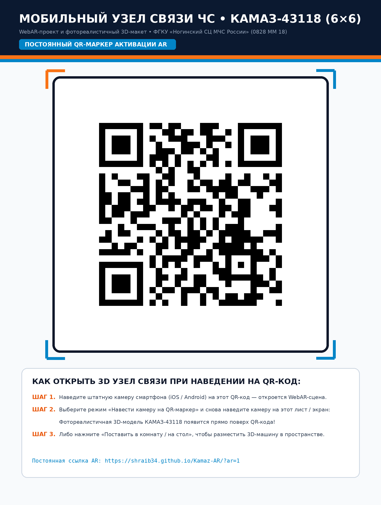

# Мобильный узел связи ЧС (КАМАЗ-43118) — WebAR & Фотореалистичный 3D-макет

Интерактивный **WebAR-проект** и фотореалистичный трёхмерный цифровой двойник мобильного пункта управления и узла связи МЧС России на полноприводном шасси **КАМАЗ-43118 (6×6)** (`0828 ММ 18`, ФГКУ «Ногинский спасательный центр МЧС России»).

### 🚀 Открыть проект онлайн
- **Основная 3D / WebAR сцена:** [https://shraib34.github.io/Kamaz-AR/](https://shraib34.github.io/Kamaz-AR/)
- **Быстрый мобильный AR-запуск (по QR):** [https://shraib34.github.io/Kamaz-AR/?ar=1](https://shraib34.github.io/Kamaz-AR/?ar=1)

---

## 📱 Запуск в дополненной реальности (AR) при наведении на QR-код

Наведите штатную камеру смартфона (iOS / Android) на QR-маркер ниже — откроется WebAR-приложение:

  

1. **AR по QR-маркеру (6-DoF трекинг в реальном времени):** откройте вкладку *«AR по QR-коду (Камера)»* и наведите камеру на этот QR-код (распечатанный на листе А4 или открытый на экране монитора) — 3D-комплекс КАМАЗ-43118 появится прямо поверх маркера.
2. **AR в реальном пространстве (AR Quick Look / Scene Viewer / WebXR):** откройте вкладку *«AR в Пространстве»*, чтобы разместить полноразмерную или настольную 3D-машину на полу, столе или улице.
3. **Интерактивный 3D-обзор:** вращайте модель на 360°, переключайте походное и рабочее положение (подъём телескопической пневмомачты с PTZ-камерой, наведение спутниковой станции VSAT `iNetVu`, открытие боковых и кормовых дверей КУНГа, откидывание трапов и аппарели), включайте проблесковую балку СГУ и радиолучи.

---

## 📂 Структура репозитория

- `index.html`, `assets/` — собранное WebAR-приложение (раздаётся через GitHub Pages).
- `models/kamaz_comms_hub.glb` — фотореалистичная PBR 3D-модель в формате glTF 2.0 Binary (`.glb`, 23 анимируемых узла, проекционные фототекстуры + карты `Normal` и `ORM`).
- `photos/` — обзорные фотографии реального образца для сравнения в интерфейсе.
- `QR_AR_Marker_Kamaz_Permanent.png` — готовый к печати плакат с постоянным QR-маркером.
- `source/` — полные исходники проекта (`Three.js`, `jsQR` 6-DoF гомография в `SO(3)`, `@google/model-viewer`, а также Python-генераторы `extract_photo_textures.py` и `generate_model.py`).
